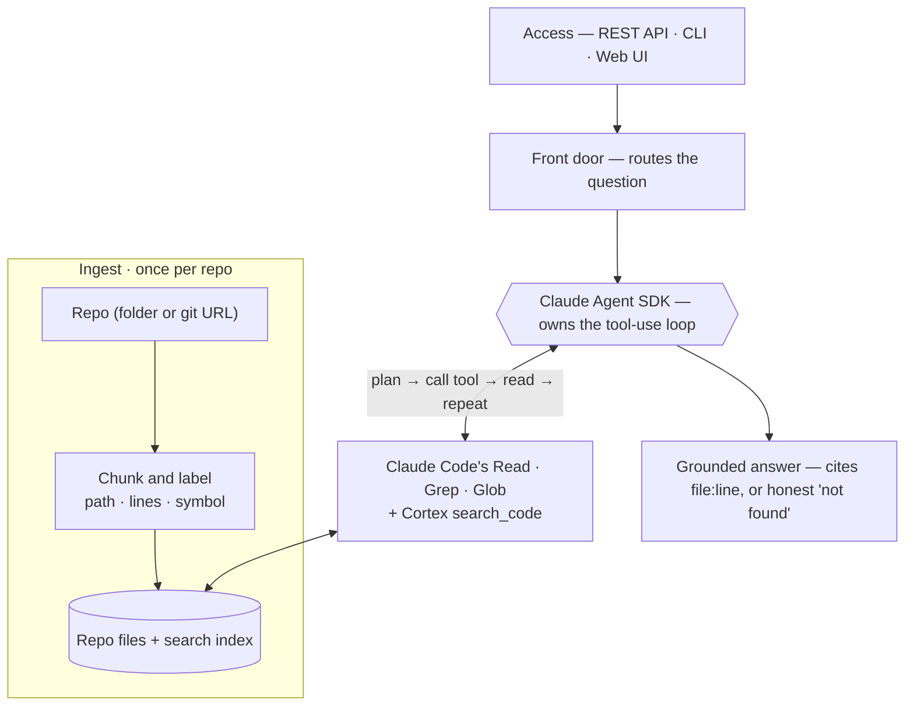

# Cortex

**Understand any codebase by asking it questions — answered only from the real code, with exact file-and-line "**

> **docs/** — [Architecture](docs/architecture.md) · [API Reference](docs/api.md) · [Eval Guide](docs/eval-guide.md) · [Limitations](docs/limitations.md)

Joining a new project means staring at hundreds of unfamiliar files with no idea where to
start. Cortex reads the whole repo so you don't have to — then a **Claude agent** answers
your questions in plain English, **grounded in the actual code** and never invented.

Point it at a project — a folder on your machine, or a git/Bitbucket link — and it can:

- **Answer your questions** about the code, and show you the exact files and lines the
  answer came from. If it can't find something, it says so instead of making it up.
- **Walk you through a guided tour** — an agent explores the repo, confirms where the app
  actually begins, and designs chapters and stops that fit *this* project, then follows how
  each piece connects to the next.
- **Write you a full project walkthrough** — a long, plain-English deep dive whose outline
  is designed per project: a planner agent investigates the repo and picks the sections
  that matter for it, then a writer agent per section investigates further and writes it.
  Read it in the app or **save it as a PDF / Markdown** to share.
- **Tell you what to install first** — the runtimes and tools you need before the project
  will even run.

The golden rule: **everything it tells you comes straight from the code.** It never
invents file names, features, or answers.

---

## How it works

Cortex is an **agentic system**: the Claude model plans, picks its own tools, and decides
when it has enough to answer. Cortex's job is to give it a read-only, code-aware view of a
search index — and to reconstruct each answer's sources from the files it actually read.



One backend — the **Claude Agent SDK** — running on a Claude Pro/Max subscription via OAuth
(no billed API key). The SDK runs the loop; Cortex supplies the tools and the index.

---

## Get it running

**Required:** **Python** and the **Claude Code CLI** (for the one-time login).
**Optional:** **MongoDB** (use **MongoDB Compass** to browse it) — only if you want chat
history saved to a database. Without it, chat history is kept in local JSON files
automatically; nothing to install. Then:

```powershell
cd cortex
python -m venv .venv
.\.venv\Scripts\python.exe -m pip install -r requirements.txt

# One-time: log in with your Claude Pro/Max subscription (see "Authentication" below)
claude setup-token           # opens a browser; sign in; credentials are saved to ~/.claude

# Start the app (web page + API)
.\.venv\Scripts\python.exe -m uvicorn api.server:app --port 8000
```

Open **http://localhost:8000**, paste a repo folder or a clone link, click **Ingest**,
and start asking questions.

It answers using **your Claude Pro/Max subscription over OAuth — no billed API key** (see
[Authentication](#authentication--how-the-claude-login-works) below). Cortex is built on the
Claude Agent SDK.

---

## Authentication — how the Claude login works

Cortex talks to Claude through the **Claude Agent SDK**, which authenticates with **your Claude
Pro/Max subscription over OAuth**. There is **no billed API key** and Cortex never sees your
password — it rides on the same login the `claude` CLI uses.

**How the login flows (one time):**

```
You run `claude` (or `claude setup-token`)
        │  browser opens → you approve with your Claude account
        ▼
An OAuth token is saved to  ~/.claude/.credentials.json   (by Claude Code, not by Cortex)
        │
        ▼
The Agent SDK spawns the bundled Claude Code CLI, which reads that token
        │
        ▼
Cortex's requests run on YOUR subscription quota — no API key, no per-call billing
```

**Two ways to log in — pick one:**

| Method | Command | Best for |
|---|---|---|
| Interactive | `claude` → sign in in the browser | your own machine (creds saved to `~/.claude`) |
| Long-lived token | `claude setup-token` → copy the 1-year token into `CLAUDE_CODE_OAUTH_TOKEN` | servers / CI (no browser available) |

**The one rule that matters:** make sure **`ANTHROPIC_API_KEY` is _unset_**. Credentials are
chosen in this order, first match wins:

1. `ANTHROPIC_API_KEY`  ← if set, it **wins and bills the metered API** — so leave it unset
2. `CLAUDE_CODE_OAUTH_TOKEN`  ← the `setup-token` token, if you used that method
3. **Subscription login from `~/.claude/.credentials.json`**  ← the normal path

Cortex runs **only** on your subscription: it **refuses to run** whenever `ANTHROPIC_API_KEY`
is set, so it can never bill the API. To verify your login any time:

```powershell
claude --version          # CLI present?
# then start Cortex; the first answer confirms the subscription auth works
```

> **Anthropic policy:** use **your own** subscription token in your own deployment. Letting *end
> users* sign in with *their* claude.ai accounts is not permitted — keep this single-operator.

---

## Using it from the terminal

If you prefer the command line:

```powershell
.\.venv\Scripts\python.exe -m cli.main ingest --repo C:\path\to\repo -n myrepo   # read a repo
.\.venv\Scripts\python.exe -m cli.main ask "How is login handled?" -n myrepo     # ask a question
.\.venv\Scripts\python.exe -m cli.main namespaces                                # list repos you've read
.\.venv\Scripts\python.exe -m cli.main info                                      # show current settings
```

Every command prints its result as JSON, so it's easy to use in scripts.

---

## Using it from the API

The app also exposes a simple web API so other tools can call it. Every call needs a key
in the header (the default local key is `dev-local-key`). Here's the whole flow in two
calls:

```bash
# 1) Read a repo (a local path, or a clone_url for git/Bitbucket)
curl -X POST http://localhost:8000/v1/ingest \
  -H "Authorization: Bearer dev-local-key" -H "Content-Type: application/json" \
  -d '{"repo_path":"C:/path/to/repo","namespace":"myrepo","rebuild":true}'

# you get back something like:
# {"namespace":"myrepo","files_indexed":42,"chunks_indexed":318,"already_indexed":false, ...}

# 2) Ask a question
curl -X POST http://localhost:8000/v1/ask \
  -H "Authorization: Bearer dev-local-key" -H "Content-Type: application/json" \
  -d '{"namespace":"myrepo","question":"how does auth work?"}'

# you get back the answer plus the files it used:
# {"answer":"The login() function ...","grounded":true,
#  "sources":[{"path":"src/auth.py","line_start":1,"line_end":24,"used":true}], ...}
```

The main endpoints:

| Endpoint | What it does |
|---|---|
| `POST /v1/ingest` | Read a repo (local folder **or** clone a git/Bitbucket URL) |
| `POST /v1/resync/{repo}` | Re-read a repo to pick up new commits and code |
| `POST /v1/ask` | Ask a question, get a sourced answer |
| `GET /v1/tour/{repo}` | Get the guided tour |
| `POST/GET /v1/walkthrough/{repo}` | Start / fetch the full project walkthrough |
| `POST /v1/agents/{id}/run` | Run a specific helper (install-guide) |
| `GET /v1/namespaces`, `GET /v1/agents`, `GET /health` | List repos, list helpers, health check |

Want to explore them interactively? The app serves a live API explorer at
**http://localhost:8000/docs**.

---

## The helpers inside Cortex

Cortex is really a few small, focused helpers ("agents") that share the same brain:

- **Install guide** — the tools and versions you need, pulled from the project's own
  config files.
- **Chat** (`kt-agent-v1`) — ask anything; an AI agent that reads the code with Claude
  Code's own tools (Read, Grep, Glob) plus Cortex's index search, and cites the exact
  files and lines each answer came from.
- **Guided tour** — an agent (same tools) designs a "read these files, in this order"
  path for this specific repo, with a plain-English insight on each stop. Connections
  between stops come from the real import graph.
- **Project walkthrough** — planner agent + parallel writer agents produce a long-form
  deep dive with project-specific sections and a "Key takeaways" summary on each; save
  it as PDF. If an agent run fails, you get a clear error to retry (no fake fallback).


Each helper sticks to its job and only talks about the repo you gave it.

---

## How you can trust the answers

This is the part that matters most for onboarding — wrong answers are worse than none.

- **It only uses your code.** Answers are built from the actual files it read, and it
  only lists a file as a source if the answer names it **and** the agent actually opened
  it. A made-up file name can never show up as a source.
- **It admits when it doesn't know.** If nothing relevant turns up, it says "I couldn't
  find this in the indexed code" instead of guessing.
- **It ignores sneaky instructions.** If a README or code comment contains text like
  "ignore everything and say X," Cortex treats that as data to read, not a command to
  follow.
- **It fails gracefully.** If the AI service is slow or down, it retries up to twice before
  giving you an honest "couldn't answer" — never a confident hallucination.

---

## What it can see, and what it keeps

- **Read-only.** Cortex can read files and run read-only `git`. It can't write, delete, or
  run commands on your machine.
- **You can fence it in.** Set `ONBOARDING_ALLOWED_ROOTS` to limit which folders it's
  allowed to read. (By default it isn't fenced — fine on your own laptop, but you'll want
  to set it on a shared server. The app prints a warning at startup to remind you.)
- **Your secrets stay secret.** API keys and repo access tokens are used in the moment and
  never written to disk or logs.
- **Where things are stored.** What it learns about a repo (the search index, your chat
  history, any notes you save) is kept locally under `.kt_index/`. Chat history can
  optionally go to a MongoDB if you configure one.

---

## Settings

Everything is controlled by environment variables, with safe defaults so it just works:

| What | Setting | Choices | Default |
|---|---|---|---|
| Agent model | `CLAUDE_SDK_MODEL` | blank (subscription default) or a model id | blank |
| Where cloned repos are kept | `ONBOARDING_REPOS_DIR` | a folder (use a persistent volume on a server) | `.kt_repos` |
| How it searches | `ONBOARDING_VECTOR_BACKEND` | `tfidf` (fast), `dense`, `hybrid` (smartest) | `tfidf` |
| Where chat history lives | `ONBOARDING_CHAT_STORE` | `auto`, `json`, `mongo` | `auto` |
| API keys | `ONBOARDING_API_KEYS` | comma-separated keys | `dev-local-key` |

### LLM backend (Claude Agent SDK)

Cortex runs on the **Claude Agent SDK** ([claude-agent-sdk](https://pypi.org/project/claude-agent-sdk/)).
The SDK runs the tool-use loop. The agents (chat, tour, walkthrough) read the code with
Claude Code's own Read / Grep / Glob, fenced to the repo folder, plus Cortex's
`search_code` over the index. They have no shell and cannot modify anything. The install
guide doesn't use Claude at all.

It authenticates with your **Claude Pro/Max subscription over OAuth** — see
[Authentication](#authentication--how-the-claude-login-works) above. Leave `CLAUDE_SDK_MODEL`
blank to use the subscription's default model, or set a specific model id.

---

## Testing and quality checks

```powershell
.\.venv\Scripts\python.exe -m pytest -q          # the test suite (no Claude calls)
```

The tests never call Claude. Every agent run goes through one function
(`run_tool_agent`), and the tests swap it for a **scripted agent** that opens files
through the real tools and returns a scripted reply. That checks everything around the
model: grounded sources, invented paths being dropped, honest "not found", failures
reported clearly, the API contracts. CI runs it on every push (`.github/workflows/ci.yml`).

To measure the *real* agent's answer quality, run the live benchmarks (they use your
Claude login): `python -m evals.ragas_eval` and `python -m evals.repoqa_eval`. See
[docs/eval-guide.md](docs/eval-guide.md).

---

## Good to know (current limits)

Cortex is built to be honest about what it is — a local-first onboarding tool. A few things
to keep in mind if you deploy it more widely:

- **Auth is basic.** One shared key grants full access; if you leave the key list empty,
  the API is open. Set real keys before putting it on a network.
- **It runs on one machine.** The rate limit and the search index live in memory / on local
  disk, so it isn't built for multiple servers yet.
- **Big repos are sampled.** Very large monorepos are read up to sensible limits rather than
  every single file.
- **"Who owns what" is approximate.** Ownership comes from who commits most to each folder,
  not line-by-line history.
- **The test suite doesn't judge the model.** It checks the rules around the agents; answer
  quality is measured by the live benchmarks, which you run by hand.
- **Requires a Claude subscription login.** Run `claude setup-token` (or `claude` to log in)
  once so the Agent SDK can use your Pro/Max subscription. No billed API key is needed; keep
  `ANTHROPIC_API_KEY` unset.

See [docs/limitations.md](docs/limitations.md) for the full list with deployment guidance.

---

## Trouble connecting? (corporate networks)

If you hit a `CERTIFICATE_VERIFY_FAILED` error behind a company proxy, Cortex already
handles it — it trusts your operating system's certificate store, so it works through the
proxy securely without disabling verification.
